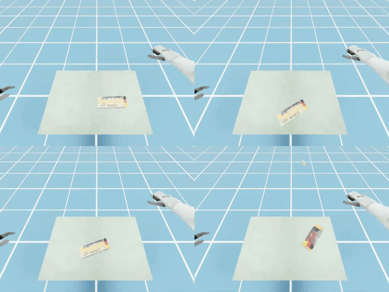
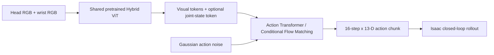

# Robot Imitation Learning for A2D Manipulation

[中文技术记录](README.zh-CN.md) · [Main research overview](https://github.com/alex7537/flow-matching-test-a2d-v2) · [Personal website](https://alex7537.github.io/)

This project trains vision-conditioned policies to generate continuous arm and hand actions from demonstrations, and evaluates them in Isaac simulation. **Conditional Flow Matching is the main grasping baseline**; Diffusion Policy and IMLE are implemented as alternative policy families.

This branch presents rollout examples and the historical V3 training setup. The [main branch](https://github.com/alex7537/flow-matching-test-a2d-v2) tracks the broader research pipeline and newer experiments.

## Demonstrated behavior

The montage shows selected successful simulated grasp rollouts. **It demonstrates individual behaviors, not an aggregate success rate or a ranking of policy families.**

- [Scene-view MP4](docs/assets/grasp_success_montage.mp4)
- [100 selected successes: GIF](docs/assets/grasp_success_grid_10x10.gif) · [MP4](docs/assets/grasp_success_grid_10x10.mp4) · [Source manifest](docs/assets/grasp_success_grid_10x10_sources.json)
- [20 wrist-camera examples: GIF](docs/assets/wrist_success_grid_20.gif) · [MP4](docs/assets/wrist_success_grid_20.mp4) · [Source manifest](docs/assets/wrist_success_grid_20_sources.json)

The 100-clip gallery uses the v17 strict 10 cm lift selection. The wrist gallery is a separate batch with a 5 cm lift and multi-finger contact criterion; later drops do not revoke success in that batch. These galleries use different criteria and should not be combined into one score. See the [Chinese technical record](README.zh-CN.md) for the complete selection rules.

## Model and data flow

| Component | Design used in the main CFM baseline |
|---|---|
| Visual backbone | ImageNet-pretrained `vit_small_r26_s32_224`; shared between the two views, with 49 spatial tokens per view |
| Action model | 4-layer Transformer, hidden dimension 384, 4 attention heads |
| Learning objective | Conditional Flow Matching: learn the velocity from Gaussian noise toward demonstration action chunks |
| Inference | 5 Euler integration steps to generate an action chunk |
| Observation / target | Current RGB and optional actual joint state → the next 16 steps; 7 executed arm-joint positions + 6 commanded hand-joint targets |

## Engineering work in this repository

- A shared observation/action interface for Flow Matching, Diffusion Policy, and IMLE.
- Demonstration preprocessing with exact duplicate removal, episode-level splits, masked tail padding, and transition/lift sampling.
- Training with deterministic validation, EMA weights, and recoverable checkpoint artifacts.
- Deployment bundles that record action semantics and checkpoint provenance, plus rollout examples with source manifests.

The historical setup documented on this branch uses **1,090 successful demonstration episodes**, split into 981 training and 109 validation episodes. This is a training-data count, not a rollout success rate. Offline loss and selected videos alone do not establish comparative closed-loop performance.

## Where to look next

| Question | Entry point |
|---|---|
| How is the CFM policy implemented? | [Flow Matching policy](flow_matching_test/policies/flow_matching.py) |
| Which backbone and training settings are used? | [Historical V3 configuration](configs/a2d_450gb_v3_hybrid_hand_target_cfm_a800_100ep_scratch.yaml) |
| How are demonstrations processed? | [Data pipeline](docs/DATA_PIPELINE.md) |
| Where are the detailed experiment notes and commands? | [Original Chinese README](README.zh-CN.md) |
| What other model routes are being explored? | [Main-branch overview](https://github.com/alex7537/flow-matching-test-a2d-v2) |

Foundation models and policy methods are existing building blocks. This repository focuses on their implementation, data contracts, training, and deployment for the A2D task.
