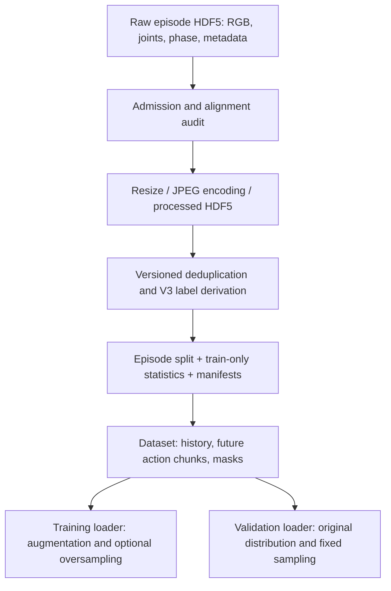

# A2D Data Pipeline

**English** | [简体中文](DATA_PIPELINE.zh-CN.md)

This guide explains how raw robot demonstrations become efficient, versioned training samples. The original Chinese record includes historical deployment commands and machine-specific notes.

## Scope and version boundaries

The original plan began with roughly 200–370 episodes on an RTX 4090; later sections describe the 1,090-episode dataset. Those storage estimates and training counts are historical examples, not properties of every current dataset.

| Contract | Observation state | Action label |
|---|---|---|
| Legacy V1/V2 | 7 actual arm + 6 actual hand joint positions | 7 actual arm + 6 actual hand joint positions |
| V3 hybrid | Same 13-D actual joint state | 7 actual arm + 6 commanded hand-joint targets |

V3 is the contract described by the current project overview. Do not mix V2 labels, statistics, checkpoints, or deployment settings with V3. The sparse arm target log is not used as dense action supervision.

## End-to-end flow



## Why preprocess?

The historical raw RGB layout used LZF-compressed chunks spanning 17 frames. Reading one random frame therefore decompressed substantially more data than the sample needed. Training at 224 × 224 also discarded much of the original 640 × 480 image.

The preprocessing route resizes images and stores each frame as a JPEG byte array in a variable-length HDF5 dataset. It preserves episode structure, joint data, phases, and relevant metadata. The original 3–5 GB output estimate applies to the early dataset plan; it is not a guaranteed size for later datasets.

## Important fields

| Source | Meaning / processed role |
|---|---|
| `trajectory/arm2_pos` | Actual arm joints, `[T,7]`; observation and arm action label |
| `trajectory/hand2_pos` | Actual hand joints, `[T,6]`; observation and legacy action label |
| `trajectory/hand2_pos_target` | Dense commanded hand targets; V3 hand action label |
| `trajectory/arm2_pos_target` | Sparse arm command events; audit only |
| `trajectory/cameras/rgb_*` | Available head/hand views; selected by `image_keys` |
| `trajectory/phase` | Phase labels retained for analysis and sampling |
| `trajectory/waist_pos` | Optional state extension requiring a motion audit |
| Depth streams | Not used by the baseline RGB-only data route |

Processed files contain `observations/qpos`, selected `observations/rgb_*`, `action`, `phase`, `segment_type`, `arm_keyframe`, and version/semantic attributes.

## Split, normalization, and indexing

- Split by **episode**, with a fixed seed, to prevent near-identical neighboring frames leaking into validation.
- Compute per-dimension min/max statistics only from training episodes. Map state/action to `[-1,1]`, protect constant dimensions with `range_eps=1e-4`, and use the documented range guard.
- Bind statistics to sorted training-episode content hashes. Dataset loading checks the digest; checkpoints carry the normalizer and provenance.
- Each worker opens HDF5 handles lazily. Do not open shared HDF5 handles in the parent and then fork.
- Write preprocessing outputs to temporary files before renaming. A changed camera selection or dataset contract requires a separate output version.
- Materialize segmentation labels and thresholds during preprocessing; the Dataset reads and validates them rather than redefining them online.

## Time alignment and tail masks

```text
observation at t -> action[t+1 : t+1+H]
default H = 16, action_offset_steps = 1
```

An older checkpoint without an explicit offset is interpreted as legacy offset 0. That is a compatibility distinction, not permission to mix the two timelines.

In complete-window mode, keep samples satisfying `t + offset + H <= episode_length`. With `include_tail_padded_windows: true`, keep tail observations that still have at least one future action, repeat the final action for padding, and return `action_mask [B,H]`. Loss and sampled-action MSE count only real timesteps.

Transition/lift oversampling changes the **training index**, not the underlying trajectory duration. Validation keeps its original distribution. The historical tail-padded 1,090-episode example with transition/lift factors of 2 has 220,026 effective training samples and 6,876 batches per epoch at batch size 32.

## Deduplication and V3 derivation

Exact deduplication compares all 13 actual joint values in consecutive frames. If they are identical, remove the earlier frame and keep the later one, preserving the later phase label. Apply the same frame mask to images, state, actions, and phases. This is not a near-static threshold filter.

V3 derivation reuses compressed RGB from V2, reads hand targets from the raw source, verifies timeline correspondence against the executed-joint keep-last mask, preserves episode membership, and recomputes action statistics and manifests. Deduplication and segmentation remain based on actual joint state, not the hybrid action label. The recorded V2→V3 transition calls for training V3 from scratch.

## Operational entry points

Start with the admission/manifest workflow:

```bash
python scripts/ingest_a2d.py \
  --src /path/to/raw_rgb_episodes \
  --output-root /path/to/datasets \
  --dataset-version a2d_rgb_complete_v1 \
  --admission complete-lift \
  --image-keys rgb_head rgb_right_hand --workers 4
```

For a direct preprocessing or derived-dataset workflow, see:

- [Preprocessor](../scripts/preprocess_a2d.py)
- [Dataset and statistics](../flow_matching_test/a2d_dataset.py)
- [Exact duplicate filter](../scripts/filter_exact_duplicate_joint_frames.py)
- [V3 hybrid-label derivation](../scripts/create_hybrid_hand_target_dataset.py)
- [Alignment audit](../scripts/check_data_alignment.py)

These are alternative/staged entry points; do not blindly execute every conversion against an existing dataset version. Use separate destinations and matching configuration files.

## Checks and open questions

Check episode counts, schema, image keys, action semantics, split/statistics digests, and one real batch before a training run. Verify dataloader throughput separately from model throughput. With no timestamps, the alignment audit can confirm indexed lengths but must report physical time alignment as `not_verifiable`.

Waist motion, acquisition/control frequency, and the physical duration represented by 16 steps still require verification for each setup. Adding depth is a new modality with its own preprocessing, normalization, synchronization, and deployment contract.

Local metrics, checkpoints, and provenance remain authoritative even when W&B synchronization fails. Historical W&B version pins and environment-specific synchronization procedures are retained in the [Chinese operational record](DATA_PIPELINE.zh-CN.md).

Next: [Vision encoder](VISION_ENCODER.md) · [Training budget](TRAINING_PLANNING_GUIDE.md) · [Deployment](DEPLOYMENT_OVERVIEW.md)
