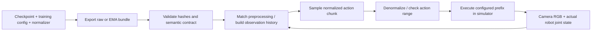

# Deployment and Closed-Loop Inference

**English** | [简体中文](DEPLOYMENT_OVERVIEW.zh-CN.md)

This guide connects the action-only training pipeline to an inference bundle and an Isaac rollout. It describes the repository's exporter/wrapper interfaces, not a newly validated robot deployment.

## Data flow

## Bundle and loader

The [exporter](../flow_matching_test/export_bundle.py) packages selected weights, inference configuration, normalization statistics, optional split membership, and a provenance manifest. It records the source checkpoint hash, selection criterion, raw/EMA variant, train step/epoch, data version, statistics digest, environments, and per-file checksums.

The [Policy wrapper](../rollout/policy_wrapper.py) validates required files, schema version, hashes, action dimension/order, statistics digests, and action semantics. It loads model weights strictly, switches to evaluation mode, and constructs the declared observation/history interface.

## Observation and output contract

For the default one-frame dual-RGB policy:

- Inputs: head RGB, right-hand RGB, and optional 13-D actual joint state.
- Visual model: shared Hybrid ViT; preprocessing, camera order, and image size must match training.
- Prediction: a 16-step × 13-D joint-position chunk.
- V3 action semantics: seven actual arm positions plus six commanded hand targets as learned labels.
- Inference output must be denormalized using the bundle's statistics before execution.

This is absolute joint-position prediction; do not reinterpret it as joint velocity or an incremental delta. Legacy executed-hand bundles require their own matching semantics.

## Prediction horizon versus execution horizon

A model may predict 16 steps but execute only a prefix before observing again. The exporter requires `1 <= execute_horizon <= chunk_size`. Shorter execution horizons change replanning and can require policy-specific continuity handling.

Also distinguish **sampling steps** from robot-action steps: five CFM Euler iterations produce one chunk; they do not mean five simulator control actions.

Keep camera preprocessing, normalization, joint order/mapping, action offset, control timing, raw/EMA choice, and policy sampling settings explicit. Environment mismatches are reported by the wrapper; successful loading alone does not demonstrate task performance.

## Evaluation evidence

1. Verify bundle integrity and fixed-reference numerical behavior.
2. Check observation/action compatibility with the simulator.
3. Run a declared initialization and success protocol.
4. Record successes, valid and invalid trials, failure stages, latency, videos, and checkpoint/bundle identity.
5. Compare methods only under matched conditions.

Simulation integration is maintained separately in the [deployment repository](https://github.com/alex7537/fk-issac-logistics), which may require access. Public rollout examples are in the [gallery branch](https://github.com/alex7537/flow-matching-test-a2d-v2/tree/docs/grasp-success-gallery).

Related: [Artifact index](../artifacts_index.md) · [Comparison protocol](POLICY_COMPARISON_PROTOCOL.md)
